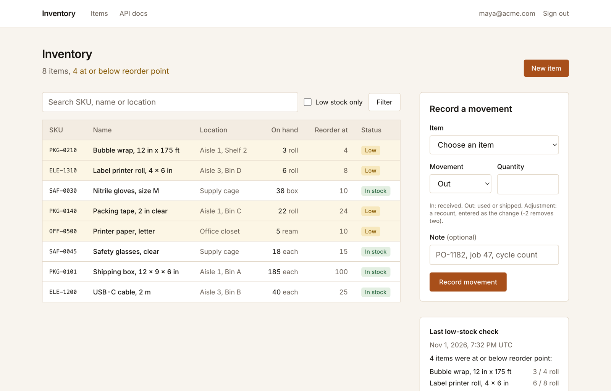

# Inventory tracker template for floo

A shared inventory tracker for a warehouse, stockroom or office: your team signs in, records stock in and out, and sees what is running low.



## What you get

- **Sign-in for your team, with roles.** floo runs the login. Admins add and edit items; members record stock movements. Nobody else gets in.
- **Stock that always adds up.** Every change is a movement (in, out or adjustment) with who, when and a note. Quantity on hand is updated in the same database transaction, so it always equals the sum of the movements and can never go below zero.
- **Low-stock view.** Search by SKU, name or location, filter to items at or below their reorder point, and open any item for its full movement history.
- **Daily low-stock check.** A floo cron job records which items need reordering every morning, and the item list shows the latest check.
- **Agent API.** Your agents can list low-stock items, read an item with its recent movements and record movements, with an app API key and a generated OpenAPI document.
- **Managed Postgres.** Migrations run once per deploy. Nothing to provision.

## Deploy with your agent

Paste this into Claude Code, Codex or Cursor:

```text
Deploy the template at https://github.com/getfloo/inventory-tracker-template on floo for me.
Follow https://getfloo.com/agents.md to create a floo-hosted project, replace its
starter code with this template's files (keep the project's [app] name in
floo.app.toml), push, and give me the live URL.
```

Or do it yourself. Click **Use this template** on GitHub to create your own repository, then:

```sh
curl -fsSL https://getfloo.com/install.sh | bash
floo auth login
# Install the floo GitHub App on your repository's owner:
#   https://github.com/apps/getfloo/installations/new
floo apps github setup
floo apps github connect <owner>/<repo>
floo apps github status --app inventory-tracker
floo deploys status --app inventory-tracker --json
```

`connect` creates the app and deploys it. Every push to your default branch deploys again. Then invite your team, and make at least one person an admin so they can add items:

```sh
floo apps invite teammate@example.com --role member --app inventory-tracker
floo apps invite lead@example.com --role admin --app inventory-tracker
```

To give an agent access to the API, mint a key with the `api` scope:

```sh
floo apps consumers create restock-agent --app inventory-tracker
floo apps keys create restock-agent-key --consumer restock-agent --scope api --app inventory-tracker
```

## Customize

Ask your agent to extend it. For example:

- "Add a suppliers table and a supplier on each item, and show the supplier's contact on the low-stock check."
- "Add a CSV export of the item list and of an item's movement history."
- "Let admins archive an item so it leaves the list but keeps its history."
- "Add a `transfer` that moves stock between two locations as one out and one in, in a single transaction."
- "Add a reorder quantity per item and a page that lists what to order from each low-stock check."

`AGENTS.md` tells the agent how this app is put together and which rules to keep.

## Local development

```sh
npm install
floo dev --fixture-user you@example.com --fixture-role admin
floo run --service web -- npm run seed   # sample items, only into an empty database
npm test
```

`floo dev` runs the migrations and the app against your app's dev database and prints an auth-proxied URL that signs you in as the fixture user. `npm run seed` loads sample items and movements and is never run on deploy. `npm test` needs no database.

## How it works

| Route | Who | What |
|---|---|---|
| `/` | everyone signed in | Item list, search, low-stock filter, quick movement form, last low-stock check |
| `/items/[id]` | everyone signed in | Item details, movement form, latest 50 movements |
| `/items/new`, `/items/[id]/edit` | admins | Add an item (with an opening quantity), edit its details |
| `/api-docs` | everyone signed in | The API reference |
| `/api/*` | API keys with the `api` scope | The agent API |

**Roles.** floo sends each person's app role (`admin` or `member`) in a header that only its gateway can set. The server checks it on every admin page and action.

**Data model.**

- `items`: SKU (unique), name, location, unit, quantity on hand, reorder point.
- `stock_movements`: item, kind (`in`, `out`, `adjustment`), signed quantity change, note, who recorded it, when.
- `low_stock_reports`: one row per daily check, with the low items at that moment.
- `users`: people who have signed in, synced from floo.

**API.**

| Method | Path | What |
|---|---|---|
| `GET` | `/api/items?low=true&q=tape` | List items, optionally only low stock or matching a search |
| `GET` | `/api/items/{id}` | An item and its 20 most recent movements |
| `POST` | `/api/items/{id}/movements` | Record `{"kind": "out", "quantity": 2, "note": "job 47"}` |
| `GET` | `/api/openapi.json` | The OpenAPI document |

**Cron.** `[cron.low-stock]` in `floo.app.toml` runs `scripts/low-stock.ts` at 13:00 UTC every day, in the web service's image with the same database. Run it now with `floo cron run low-stock --app inventory-tracker`.

---

Built on [floo](https://getfloo.com): build internal software.
